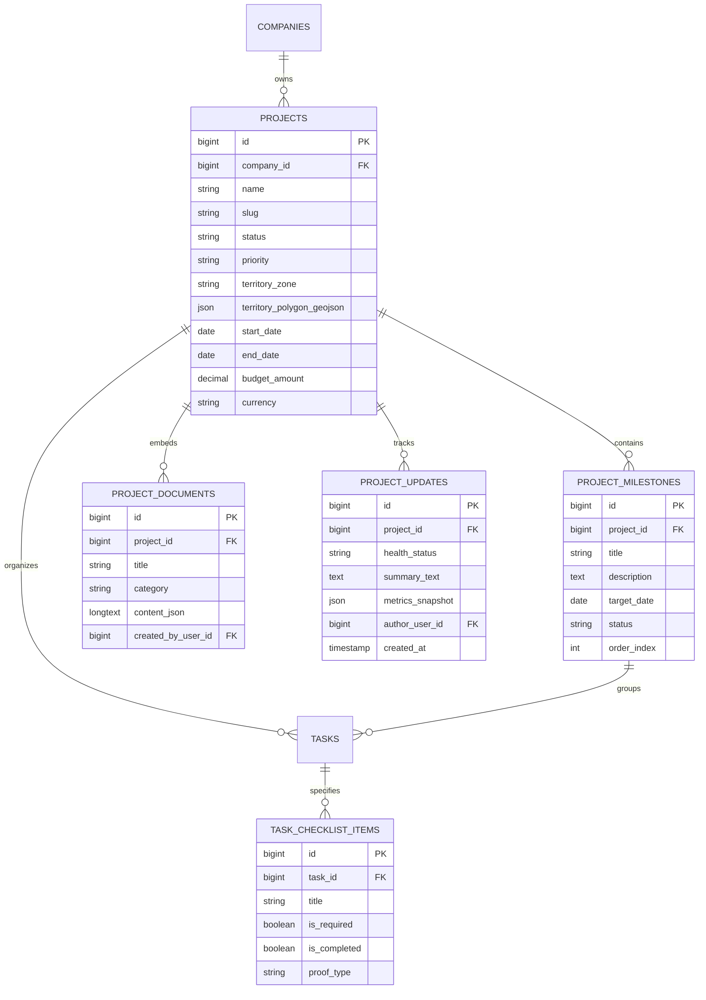

# Factory 23 Projects: Strategic Product Enhancement & Feature Recommendation Document

> **Author**: Senior Product Development & Architecture Advisory  
> **Target Audience**: Product Leadership, Engineering, Operations Directors, and UI/UX Teams  
> **Status**: Comprehensive Product Recommendation (RFC)  
> **Date**: November 2026  
> **Inspiration**: Linear, Notion, JIRA, Asana, and Field Operations Management Systems

---

## 1. Executive Summary & Strategic Vision

### 1.1 The Opportunity
Modern software teams enjoy best-in-class product management tools like **Linear** (unrivaled speed, cycles, opinionated status flow), **Notion** (flexible multi-modal views, rich documentation, modular blocks), and **JIRA** (enterprise governance, granular workflows, dependency tracking). 

However, **field operations, distributed workforce, and fleet execution platforms** have historically been neglected, forced to choose between rigid enterprise ERPs or generic ticket trackers that lack physical context.

Factory 23 holds a unique strategic advantage: it bridges the gap between **high-level business initiatives** and **on-the-ground physical execution** (GPS tracking, verification proofs, geofenced journeys, attendance, and commission-driven field agents).

### 1.2 The Core Thesis
We must evolve the **Projects** section of Factory 23 from a static "task list with a Kanban board" into an **Adaptive Physical Operations Engine**. 

```
                               ┌────────────────────────────────────────────────┐
                               │           THE FACTORY 23 MOAT                  │
                               │  (Live GPS, Geofences, Proofs, Field Workforce)│
                               └──────────────────────┬─────────────────────────┘
                                                      │
         ┌───────────────────────────┬────────────────┴───────────────────────────┐
         ▼                           ▼                                            ▼
 ┌───────────────┐           ┌───────────────┐                            ┌───────────────┐
 │    LINEAR     │           │    NOTION     │                            │     JIRA      │
 │  Inspiration  │           │  Inspiration  │                            │  Inspiration  │
 ├───────────────┤           ├───────────────┤                            ├───────────────┤
 │ • Cycles      │           │ • Multi-Views │                            │ • Milestones  │
 │ • Project     │           │   (Table,     │                            │ • Workload &  │
 │   Updates     │           │   Gantt, Map) │                            │   Capacity    │
 │ • Opinionated │           │ • Living Brief│                            │ • Custom      │
 │   Velocity    │           │ • Rich SOPs   │                            │   Workflows   │
 └───────────────┘           └───────────────┘                            └───────────────┘
```

By fusing **Linear's velocity and asynchronous project updates**, **Notion's polymorphic views and living documentation**, and **JIRA's milestone scoping and capacity planning** with **Factory 23's native geospatial tracking**, we transform Projects into the central command center for company leadership, field supervisors, and operations managers.

---

## 2. Current State Audit & Structural Gap Analysis

An inspection of the existing web codebase (`app/(dashboard)/projects`, `app/(dashboard)/projects/[projectId]`, `components/operations/projects-view.tsx`, `components/operations/project-details-view.tsx`, and `backend/src/app/Services/Project/ProjectService.php`) reveals key strengths and critical gaps:

| Dimension | Existing Implementation | The Gap & Limitation | Modern PM Standard (Linear/Notion/JIRA) |
| :--- | :--- | :--- | :--- |
| **Top-Level Projects Page** | Tab switch between "All Tasks" and "KPIs"; project list was temporarily bypassed (`<AllProjectsTasksView />`). | No high-level portfolio view for executives to compare project progress, burnup rates, or deadlines across territories. | Portfolio roadmap, health indicators (On Track / At Risk), and owner accountability. |
| **Information Architecture** | Flat hierarchy: `Project -> Tasks`. | Operational campaigns require multi-stage rollouts (e.g. *Phase 1: Territory Mapping*, *Phase 2: Merchant Acquisition*, *Phase 3: Hardware Deployment*). Single tasks cannot represent this. | Milestones, Epics, Phases, and Subtask checklists. |
| **Viewing Modalities** | Only a 3-column Kanban board (`pending`, `in-progress`, `completed`) and a small sidebar calendar widget. | Operations managers handling 200+ tasks cannot scan large volumes easily on a 3-column board. Cannot see spatial clusters or timeline dependencies. | **Polymorphic Views**: Kanban Board, Spreadsheet/Table, Gantt/Timeline, Map/Spatial, and Calendar. |
| **Context & Knowledge Base** | Plain-text `description` and `notes` fields in project creation drawer. | Field operations require Standard Operating Procedures (SOPs), onboarding briefs, safety instructions, and battle-cards accessible in the project. | Rich document canvas (Notion-style), embedded PDF runbooks, and inline briefing cards. |
| **Resource & Capacity Planning** | Comma-separated or multi-select array of user IDs (`assigned_team`). | No visibility into agent availability, current workload, geographic proximity, or today's attendance status. | Workload heatmaps, capacity allocation, and attendance-linked task dispatching. |
| **Project Health & Cadence** | Algorithmic pace score (`timeline_consumption` vs `task_completion`). | Lacks qualitative narrative updates (what blocked the team, vendor delays, regulatory issues). | Asynchronous weekly project status updates with sentiment and blocker logs. |
| **Proof-of-Work Integration** | Individual task detail modal allows photo uploads. | No aggregate gallery or verification stream to inspect all proof submitted across the project in one place. | Media/Proof Review Queue with bulk approve/reject workflows. |

---

## 3. The 6 Strategic Pillars of Enhancement

```
                                  PROJECTS ENGINE
                                         │
     ┌──────────────┬──────────────┬─────┴──────┬──────────────┬──────────────┐
     ▼              ▼              ▼            ▼              ▼              ▼
 1. MULTI-      2. PHASE &     3. LIVING    4. WORKLOAD &  5. ASYNC       6. ELY AI
    MODAL          MILESTONE      DOCS &       FIELD          HEALTH         COPILOT
    VIEWS          HIERARCHY      SOPS         CAPACITY       UPDATES        INTEGRATION
```

---

### Pillar 1: Multi-Modal Project Views (Inspired by Notion & Linear)

Rather than forcing users into a single 3-column Kanban board, each Project should offer a persistent **View Switcher Toolbar** that allows switching between 5 lenses with instant state retention:

```
[ ⊞ Board ]   [ ≡ Table / Grid ]   [ ☷ Timeline / Gantt ]   [ ⚑ Territory Map ]   [ 📅 Calendar ]
```

#### 1. Interactive Table / Grid View (The Notion Experience)
- **High-Density Spreadsheet Experience**: Display 50-100 tasks on screen with inline editing for Assignee, Status, Priority, Due Date, and Territory Zone.
- **Group By & Sort**: Group tasks dynamically by:
  - *Assignee* (see each agent's queue)
  - *Milestone / Phase*
  - *Territory / Neighborhood*
  - *Priority / Status*
- **Bulk Multi-Action Toolbar**: Select 15 tasks at once to bulk reassign to a supervisor, change deadline by +3 days, or export to CSV/PDF.

#### 2. Visual Timeline / Gantt View (The Linear & Asana Experience)
- **Phase Scheduling**: Visualize milestones and task deadlines across a dynamic Day/Week/Month timeline.
- **Task Dependencies**: Draw visual connection lines between dependent tasks (`Task B: Install Fiber` cannot start until `Task A: Trench Inspection` is `completed`).
- **Critical Path Highlighting**: Automatically highlight tasks that, if delayed, will push back the project deadline.

#### 3. Spatial Territory Map View (Factory 23 Core Moat)
- **Interactive Mapbox/Google Maps Canvas**: Pin all project tasks onto a full-screen interactive map with status-coded markers.
- **Territory Geofence Polygons**: Overlay the designated project zone (e.g., "Ikeja Commercial Corridor").
- **Live Agent Presence**: Display real-time locations of agents assigned to this project so supervisors can drag an unassigned pin directly onto the nearest live agent.

#### 4. Upgraded Kanban Board (The Linear Experience)
- **Custom Columns**: Expand beyond `pending`, `in_progress`, `completed` to support:
  - `Triage / Backlog`
  - `Dispatched / In Transit`
  - `Under Review / Proof Verification`
  - `Completed`
  - `Blocked / Rescheduled`
- **Quick Filters**: Instant keyboard-driven filtering (`My Tasks`, `High Priority`, `Overdue`, `Unassigned`).

---

### Pillar 2: Hierarchical Scoping — Milestones, Phases & Subtasks (Inspired by JIRA & Linear)

Large initiatives cannot be managed as flat task lists. A commercial solar installation or FMCG retail rollout requires structured phases:

```
Project: "Q4 Lagos Island Merchant Digitization" (Goal: 500 Merchants)
 ├── Phase 1: Territory Reconnaissance & Store Tagging (Target: Oct 1 - Oct 15)
 │    ├── Milestone: 150 Key Retail Outlets Mapped
 │    └── Tasks: Task #101, Task #102...
 ├── Phase 2: POS Terminal Deployment & KYC Verification (Target: Oct 16 - Nov 15)
 │    ├── Milestone: 300 Terminals Active
 │    └── Tasks: Subtasks with Verification Checklists
 └── Phase 3: Post-Launch Support & Signage Inspection (Target: Nov 16 - Dec 15)
```

#### Key Capabilities:
1. **Milestones with Progress Rollups**:
   - Each milestone has its own due date and calculates progress automatically based on linked tasks.
   - Linear-style target date prediction: If task velocity is 4 tasks/day, highlight whether the milestone is projected to finish early, on time, or late.
2. **Task Checklists & Subtasks with Proof Requirements**:
   - Tasks can contain ordered checklist items (e.g., `[✓] Verify Store Signboard`, `[✓] Scan Merchant QR`, `[ ] Collect Owner Signature`).
   - Gated completion: A task cannot be marked completed until all mandatory checklist proofs are satisfied.

---

### Pillar 3: Living Project Docs, Briefs & SOPs (Inspired by Notion)

Field projects frequently fail because agents on the ground lack clear execution instructions. Instead of external Google Docs or WhatsApp messages, Factory 23 projects should embed a **living documentation workspace**:

```
[ Project Hub: East Africa FMCG Audit ]
 ├─ Overview & Brief (Executive summary, budget, client POCs)
 ├─ Standard Operating Procedures (SOPs for field verification)
 ├─ Field Script & Objection Handling (Guidelines for agents)
 └─ Media Assets & Brand Guidelines
```

#### Key Capabilities:
- **Rich Document Editor**: Block-based editor supporting callout boxes, checklists, embedded maps, data tables, and downloadable PDF assets.
- **Agent Briefing Sync**: When agents open a project task in the Agent PWA or Manager PWA, the linked SOP guidelines appear directly in the task sheet under a **"How to Execute"** tab.
- **Client & Vendor Reference Card**: Quick contact cards for client stakeholders, store managers, or emergency escalation contacts.

---

### Pillar 4: Workforce Capacity, Attendance & Field Readiness (Inspired by JIRA Workload)

In field operations, project planning is meaningless if the assigned agents are not physically on duty. Factory 23 can integrate **Attendance, Proximity, and Workload** directly into the project view:

```
┌──────────────────────────────────────────────────────────────────────────────────┐
│ WORKFORCE & CAPACITY MATRIX                                                      │
├──────────────────┬──────────────┬──────────────┬──────────────────┬──────────────┤
│ Agent Name       │ Status Today │ Active Tasks │ In-Zone Proximity│ Capacity     │
├──────────────────┼──────────────┼──────────────┼──────────────────┼──────────────┤
│ Ibrahim Adeleke  │ 🟢 Clocked In│ 4 Active     │ Inside Zone (1km)│ 80% (Normal) │
│ Ngozi Okafor     │ 🟢 Clocked In│ 8 Active     │ Inside Zone (3km)│ 160% (High!) │
│ David Mensah     │ 🔴 Absent    │ 3 Pending    │ Off Duty         │ ⚠️ Reassign  │
└──────────────────┴──────────────┴──────────────┴──────────────────┴──────────────┘
```

#### Key Capabilities:
1. **Attendance-Aware Dispatching**:
   - Real-time indicator showing which assigned team members have clocked in today.
   - If an agent is absent or late, an alert banner offers **"One-Click Reassign"** to distribute their urgent pending tasks to available in-zone peers.
2. **Workload Balancing Heatmap**:
   - Visual gauge showing task distribution across supervisors and agents to prevent burnout and bottlenecks.
3. **Territory Skills & Tag Matching**:
   - Match project categories (e.g. `Electrical Inspection`, `High-Value Merchant Sales`) with agent certifications and languages.

---

### Pillar 5: Async Project Updates & Executive Reporting (Inspired by Linear)

Executives and project managers do not have time to comb through hundreds of task tickets. They need high-signal, asynchronous health reporting:

```
┌──────────────────────────────────────────────────────────────────────────────────┐
│ PROJECT UPDATE #12 — Week of Oct 28                              [ 🟢 ON TRACK ] │
│ Posted by: Marcus Sterling (Supervisor) • 2 days ago                             │
├──────────────────────────────────────────────────────────────────────────────────┤
│ 🎯 Summary: Territory scanning for Zone 4 completed 3 days ahead of schedule.    │
│ 📊 Key Metrics: 240 / 300 Merchants Onboarded (80%) • 98% Proof Acceptance Rate  │
│ ⚠️ Blockers: Fuel price spike impacting commute in Zone 2; logistics route rerun.│
│ 🔮 Next Week Focus: Launching Phase 2 POS verification audits with 12 agents.    │
└──────────────────────────────────────────────────────────────────────────────────┘
```

#### Key Capabilities:
1. **Weekly Project Cadence**:
   - Prompts project leads every Friday or Monday to submit a 2-minute status update.
   - Standardized status chips: `On Track (Green)`, `At Risk (Yellow)`, `Off Track (Red)`.
2. **Automated Metric Snapshots**:
   - Updates automatically snapshot the backend analytics (`project_progress`, `task_completion`, `timeline_consumption`, `pace_gap`, and `non_commenced_agents`).
3. **Notification Broadcast**:
   - Automatically posts update highlights to project team members and sends executive email/push digests to company owners.

---

### Pillar 6: ELY AI Operations Copilot for Projects

Integrate Factory 23’s **ELY AI** directly into project lifecycle management:

```
┌──────────────────────────────────────────────────────────────────────────────────┐
│ 🤖 ELY Executive Copilot: Project Assistant                                      │
├──────────────────────────────────────────────────────────────────────────────────┤
│ "I noticed Project 'Lagos Solar Drive' has a 22% pace gap with 4 days until      │
│ milestone deadline. 5 agents have not commenced their assigned inspection tasks. │
│                                                                                  │
│ Suggested Actions:                                                               │
│ [ ⚡ Send Reminder Ping to Inactive Agents ]                                      │
│ [ 🔄 Rebalance 12 Tasks to Active In-Zone Agents ]                               │
│ [ 📝 Draft Executive Status Brief for Owner ]"                                   │
└──────────────────────────────────────────────────────────────────────────────────┘
```

#### Key Capabilities:
1. **Natural Language Task & Milestone Generation**:
   - Prompt: *"Create a 2-week retail audit project in Victoria Island with 40 grocery stores. Break it into 2 milestones and assign Ibrahim and Ngozi."*
   - ELY parses the prompt, creates the project, creates geographic tasks, and drafts the project brief.
2. **Predictive Risk & Slip Detection**:
   - Analyzes real-time commute velocity, task completion time, and historical agent performance to flag at-risk deadlines 48 hours before they occur.
3. **Auto-Generated Executive Standup Summaries**:
   - Generates weekly and end-of-project post-mortem reports summarizing total field hours, travel mileage, proofs verified, and budget efficiency.

---

## 4. Architectural Blueprint & Target UI/UX Flow

### 4.1 Redesigned Projects Index (`/projects`)

Restore the dedicated Projects overview with an Executive Portfolio Dashboard:

```
┌────────────────────────────────────────────────────────────────────────────────────────┐
│ [ Projects (18) ]    [ Global Tasks ]    [ Operations Map ]    [ Workforce KPIs ]      │
├────────────────────────────────────────────────────────────────────────────────────────┤
│ 🔍 Search projects...   [ Filter: All Statuses ▾ ]   [ Priority ▾ ]   [ + New Project ]│
├────────────────────────────────────────────────────────────────────────────────────────┤
│ ┌───────────────────────┐ ┌───────────────────────┐ ┌────────────────────────────────┐ │
│ │ Active Projects: 12   │ │ At-Risk Projects: 2   │ │ Total Field Output: 1,420 Tasks│ │
│ └───────────────────────┘ └───────────────────────┘ └────────────────────────────────┘ │
│                                                                                        │
│ [ Cards View ]  [ Table View ]  [ Roadmap View ]                                       │
│                                                                                        │
│ ┌────────────────────────────────────────────────────────────────────────────────────┐ │
│ │ ⚡ Lagos Island Solar Grid Rollout        [ Active ] [ High ]      Lead: Marcus S. │ │
│ │ Progress: [████████████████░░░░] 74% • Due: Nov 20 (18 days left) • 42/56 Tasks    │ │
│ │ Health: 🟢 On Track (Pace Score: 92) • Team: 8 Agents (7 Active Today)             │ │
│ └────────────────────────────────────────────────────────────────────────────────────┘ │
│ ┌────────────────────────────────────────────────────────────────────────────────────┐ │
│ │ 🛍️ FMCG Retail Merchant Verification     [ Active ] [ Medium ]    Lead: Sarah T.  │ │
│ │ Progress: [████████░░░░░░░░░░░░] 41% • Due: Nov 05 (3 days left) • 62/150 Tasks   │ │
│ │ Health: 🔴 At Risk (Pace Gap: 34%) • Team: 12 Agents (4 Absent Today)              │ │
│ └────────────────────────────────────────────────────────────────────────────────────┘ │
└────────────────────────────────────────────────────────────────────────────────────────┘
```

---

### 4.2 Redesigned Project Hub (`/projects/[projectId]`)

Transform the single project view into a tabbed workspace:

```
┌────────────────────────────────────────────────────────────────────────────────────────┐
│ ← All Projects  /  Lagos Island Solar Grid Rollout                   [ Edit ] [ Share ]│
│ Priority: High • Territory: Zone 4 (Lagos Island) • Lead: Marcus Sterling              │
├────────────────────────────────────────────────────────────────────────────────────────┤
│ [ Overview & Brief ]  [ Tasks & Board ]  [ Territory Map ]  [ Team ]  [ Proofs ] [Logs]│
├────────────────────────────────────────────────────────────────────────────────────────┤
│                                                                                        │
│  (When "Tasks & Board" is selected):                                                   │
│  [ ⊞ Kanban Board ]   [ ≡ Table List ]   [ ☷ Timeline / Gantt ]   [ 📅 Calendar ]      │
│                                                                                        │
│  ┌───────────────────────┐ ┌───────────────────────┐ ┌───────────────────────────────┐ │
│  │ PENDING (12)          │ │ IN PROGRESS (18)      │ │ COMPLETED (42)                │ │
│  │ ───────────────────── │ │ ───────────────────── │ │ ───────────────────────────── │ │
│  │ [Card: Site 104 Prep] │ │ [Card: Cable Trench]  │ │ [Card: Meter Inspection]      │ │
│  │ Assignee: David M.    │ │ Assignee: Ibrahim A.  │ │ Assignee: Ngozi O.            │ │
│  │ Due: Tomorrow         │ │ GPS: Inside Geofence  │ │ Proof: 4 Photos Verified ✓    │ │
│  └───────────────────────┘ └───────────────────────┘ └───────────────────────────────┘ │
└────────────────────────────────────────────────────────────────────────────────────────┘
```

---

## 5. Technical Data Model & Backend Extensions

To support these capabilities, the backend schema and domain models should be extended with clean, backward-compatible additions:

### 5.1 Proposed Schema Migrations



### 5.2 API Contract Extensions

1. **`GET /api/v1/admin/projects/{id}/hub`**:
   - Returns aggregated project payload in a single low-latency round-trip: metadata, milestones, active team attendance summary, health status, and live task counts.
2. **`POST /api/v1/admin/projects/{id}/updates`**:
   - Submits a weekly health update (`on_track`, `at_risk`, `off_track`), blocker notes, and captures analytics snapshot.
3. **`GET /api/v1/admin/projects/{id}/proofs`**:
   - High-performance paginated media gallery of all proof photos and signatures captured for tasks linked to this project.
4. **`POST /api/v1/admin/projects/{id}/bulk-task-action`**:
   - Executes atomic bulk operations (e.g. bulk reassign, bulk status transition, bulk date adjustment).

---

## 6. Prioritized Implementation Roadmap

Following agile delivery principles, we recommend phasing this transformation into **three distinct releases**:

```mermaid
flowchart LR
    subgraph Phase 1: High-Impact Foundation [Quick Wins / P0 - 4 Weeks]
        A1[Restore Executive Projects Portfolio]
        A2[Interactive Table View with Inline Editing]
        A3[Direct Territory Map View for Projects]
    end

    subgraph Phase 2: Workflow & Scoping [Core Depth / P1 - 6 Weeks]
        B1[Project Milestones & Phases Hierarchy]
        B2[Living Project Docs & SOP Canvas]
        B3[Async Weekly Health Updates Stream]
    end

    subgraph Phase 3: Intelligent Operations [Enterprise & AI / P2 - 4 Weeks]
        C1[Attendance-Aware Capacity Matrix]
        C2[Gantt / Timeline Dependency Engine]
        C3[ELY AI Copilot Project Planning]
    end

    Phase 1 --> Phase 2 --> Phase 3
```

### Phase 1: High-Impact Foundation (P0 — 4 Weeks)
- **Objective**: Restore the high-level Projects portfolio and break the limitation of the single 3-column board.
- **Deliverables**:
  1. Revive the Projects Portfolio page (`/projects`) with performance analytics cards, status filters, and search.
  2. Implement the **Table/Grid View** alongside the Kanban board with sorting and bulk actions.
  3. Introduce the **Spatial Territory Map View** inside the project details page to pin tasks geographically.

### Phase 2: Workflow & Scoping (P1 — 6 Weeks)
- **Objective**: Elevate project structure to match Linear and Notion.
- **Deliverables**:
  1. **Milestones & Phases**: Allow creating sub-stages within projects with automatic progress rollups.
  2. **Living Project Docs**: Embedded block editor for project briefs, field instructions, and SOPs.
  3. **Weekly Project Health Updates**: Enable supervisors to submit async status reports with On Track/At Risk chips.
  4. **Aggregated Project Proof Gallery**: Unified review screen for all submitted task proof photos.

### Phase 3: Intelligent Operations & AI (P2 — 4 Weeks)
- **Objective**: Full workforce synergy and AI automation.
- **Deliverables**:
  1. **Workforce Capacity & Attendance Matrix**: Real-time matching of clocked-in agents to project task queues with one-click reassignment.
  2. **Interactive Timeline / Gantt View**: Drag-and-drop schedule adjustment with dependency links.
  3. **ELY AI Project Copilot**: Automated risk alerts, natural language task generation from briefs, and executive summary exports.

---

## 7. Business Impact & Measurable KPIs

| Metric | Target Impact | Strategic Value |
| :--- | :--- | :--- |
| **Manager Time-to-Dispatch** | 🔻 **45% reduction** | Table view and territory map allow supervisors to assign 50 tasks in minutes rather than clicking individual modals. |
| **Project Deadline Slip Rate** | 🔻 **35% reduction** | Real-time pace score + weekly async health updates identify at-risk campaigns 7 days earlier. |
| **Proof Verification Velocity** | 🔺 **60% faster** | Aggregated project proof stream eliminates navigating task-by-task to approve field evidence. |
| **Executive Visibility** | 🔺 **100% real-time** | Owners gain instant portfolio visibility without requiring supervisors to manually compile PowerPoint or Excel reports. |

---

## 8. Conclusion & Next Steps

Factory 23 has built an exceptional foundation in field telemetry, attendance verification, and task dispatch. By enriching the **Projects** section with **Linear's focus on velocity and health**, **Notion's visual versatility and living documents**, and **JIRA's enterprise milestone structuring**, Factory 23 will deliver an unparalleled operations management platform that empowers both executive leadership and frontline teams.

**Recommended Immediate Next Step**:
1. Review and align on Phase 1 priorities with design and engineering teams.
2. Finalize UI wireframes for the **View Switcher (Board / Table / Map)** and **Project Portfolio Dashboard**.
3. Create the Phase 1 backend ticket specifications for database migrations and API endpoints.

